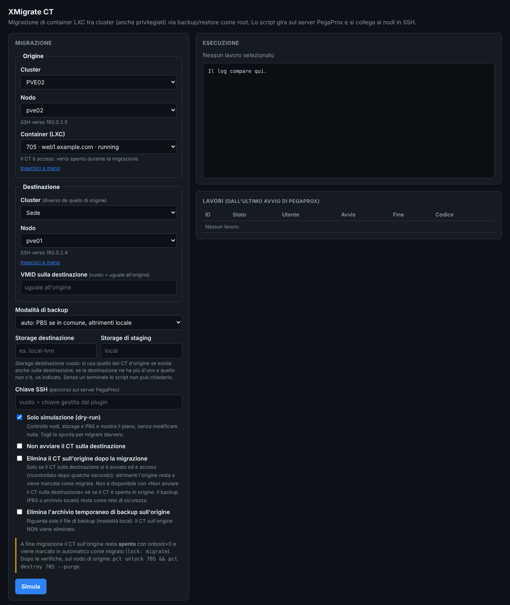

# XMigrate CT

Plugin per [PegaProx](https://pegaprox.com) che migra **container LXC, anche privilegiati, tra cluster Proxmox VE** quando PDM e la migrazione cross-cluster di PegaProx si fermano con un errore 403.

[](https://github.com/LeleKaos/pegaprox-xmigrate-ct/actions/workflows/test.yml)
[](LICENSE)

> **English summary.** A PegaProx plugin (plus a standalone bash script) that moves privileged LXC containers between Proxmox VE clusters via backup/restore run as `root` over SSH, which avoids `403 changing feature flags for privileged container is only allowed for root@pam` that Proxmox Datacenter Manager and PegaProx hit when they migrate with an API token. It adds a tab to PegaProx with cluster/node/CT dropdowns, a dry-run, live logs, and an optional "delete the source only if the CT started on the destination" step. The interface and messages are in Italian only for now. Install with `curl -fsSL https://raw.githubusercontent.com/LeleKaos/pegaprox-xmigrate-ct/main/install.sh | sudo bash`. Not affiliated with the PegaProx project.



## Il problema

PDM e PegaProx migrano tra cluster con un token API. Per i CT **privilegiati** Proxmox riserva a `root@pam` (un utente vero, non un token) la modifica di `features` e delle righe `lxc.*`, quindi la migrazione finisce con:

```
403 changing feature flags for privileged container is only allowed for root@pam
```

XMigrate CT evita il problema: fa backup e restore **come root via SSH**, che non ha questo limite e mantiene la configurazione così com'è.

## Come funziona

Lo script `xmigrate-ct.sh` gira sul server PegaProx e raggiunge i due nodi in SSH:

1. controlli: nodi raggiungibili, CT esistente e senza lock, non in HA, VMID libero sulla destinazione, bridge e storage presenti, spazio sufficiente;
2. spegne il CT sull'origine (se era acceso);
3. backup: **PBS** se lo stesso PBS è attivo su entrambi i nodi, altrimenti `vzdump` su uno storage locale e copia verso la destinazione con verifica **sha256**;
4. `pct restore` sulla destinazione, come root;
5. avvia il CT sulla destinazione (se era acceso) e ne verifica l'avvio;
6. sull'origine: `onboot=0` e **`lock: migrate`** (vedi sotto); oppure eliminazione, solo se richiesta.

Se qualcosa va storto prima della fine, un rollback riavvia il CT sull'origine (a meno che sia già acceso sulla destinazione) e ti dice cosa è rimasto da ripulire. Con "Solo simulazione" (`--dry-run`) fa tutti i controlli e mostra il piano senza toccare nulla.

### Cosa succede al CT sull'origine

- **Di default** resta **spento** con `onboot=0` e viene marcato come "migrato" con `lock: migrate`, come fa Proxmox dopo una `remote-migrate` senza `--delete`. Il lock impedisce un avvio per sbaglio e si vede subito. Dopo le verifiche, sul nodo di origine:

  ```
  pct unlock <vmid> && pct destroy <vmid> --purge
  ```

- **Con "Elimina il CT sull'origine"** (`--destroy-src`) lo elimina (`pct destroy --purge`) **solo se il CT sulla destinazione si è avviato ed è ancora acceso dopo qualche secondo**. Se la verifica o l'eliminazione falliscono, l'origine resta, viene marcata e lo script esce con codice 3. L'opzione non è disponibile con "Non avviare il CT sulla destinazione" né se il CT era spento in origine (in quel caso non si può verificare l'avvio). Il backup (PBS o archivio locale) resta come rete di sicurezza.

## Requisiti

- PegaProx 1.4.0 o successivo.
- Sul server PegaProx: `bash` ≥ 4.3, `ssh` e `ssh-keygen` (pacchetto `openssh-client`), `jq` (l'installer lo mette se manca). Facoltativo: `pv` per la barra di avanzamento.
- Accesso SSH come `root` ai nodi Proxmox (con la chiave del plugin, vedi sotto).
- Chi usa il plugin deve avere in PegaProx il permesso **`plugins.manage`**; basta `plugins.view` per vedere la tab, ma non per avviare lavori.

## Installazione

### Automatica (consigliata)

Sul server PegaProx, come root:

```bash
curl -fsSL https://raw.githubusercontent.com/LeleKaos/pegaprox-xmigrate-ct/main/install.sh | sudo bash
```

Se preferisci leggere lo script prima di eseguirlo, o fissare una versione:

```bash
curl -fsSLO https://raw.githubusercontent.com/LeleKaos/pegaprox-xmigrate-ct/main/install.sh
less install.sh
sudo bash install.sh --ref v1.1.0
```

L'installer trova da solo la cartella dei plugin (variabile `PEGAPROX_PLUGINS_DIR`, servizio systemd, oppure `/opt/PegaProx/plugins`, `/opt/pegaprox/plugins`, `/var/lib/pegaprox/plugins`), controlla la sintassi dei file, **salva la versione precedente in `/var/backups/xmigrate_ct`** (ne tiene 5), sostituisce i file senza toccare uno script eventualmente in esecuzione, rifiuta di aggiornare mentre una migrazione è in corso e installa `jq` se manca.

| Opzione | Effetto |
|---|---|
| `--dir DIR` | cartella dei plugin (se non viene rilevata o ce ne sono più di una) |
| `--ref RIF` | ramo, tag o commit da installare (default `main`) |
| `--restart` | riavvia il servizio `pegaprox` alla fine (interrompe sessioni e lavori in corso) |
| `--uninstall` | rimuove il plugin (con backup) |
| `--no-deps` | non installare `jq` |
| `--no-backup` | non salvare la versione precedente |
| `--force` | prosegue anche con una migrazione in corso (sconsigliato) |
| `-n`, `--dry-run` | mostra cosa farebbe, senza modificare nulla |

Dopo l'installazione, in PegaProx: pagina dei plugin → **Rescan**, attiva **XMigrate CT (privileged)**, poi F5. Compare la tab *XMigrate CT (privileged)* dentro i cluster. In un aggiornamento basta disattivare e riattivare il plugin (o `--restart`).

### Manuale

```bash
git clone https://github.com/LeleKaos/pegaprox-xmigrate-ct.git
sudo mkdir -p /opt/pegaprox/plugins/xmigrate_ct              # la tua cartella plugin
sudo cp pegaprox-xmigrate-ct/plugin/xmigrate_ct/* /opt/pegaprox/plugins/xmigrate_ct/
sudo chmod +x /opt/pegaprox/plugins/xmigrate_ct/xmigrate-ct.sh
sudo chown -R --reference=/opt/pegaprox/plugins /opt/pegaprox/plugins/xmigrate_ct
```

I file sono quattro: `manifest.json`, `__init__.py`, `ui.html`, `xmigrate-ct.sh`. Poi Rescan e attivazione come sopra.

### Docker

Il plugin deve stare nel volume dei plugin (`PEGAPROX_PLUGINS_DIR`, di solito `…/config/plugins`). Con il volume montato sull'host: `sudo bash install.sh --dir /percorso/del/volume/plugins`. Nel container servono `ssh`, `ssh-keygen` e `jq`: se l'immagine non li ha, vanno aggiunti all'immagine (l'installer gira sull'host e non può farlo).

## Primo uso

1. **Chiave SSH.** Nella tab apri *Chiave SSH del plugin* → *Mostra chiave pubblica*. Il plugin genera da solo una chiave `ed25519` (`~/.ssh/xmigrate_ct_ed25519` dell'utente che esegue PegaProx). Aggiungi la chiave pubblica a `~/.ssh/authorized_keys` di **root** su un nodo di ciascun cluster (origine e destinazione). A mano, oppure dal pannello con la password di root (serve `paramiko` o `sshpass` sul server PegaProx). Suggerimento: restringi la chiave con `from="IP_DEL_SERVER_PEGAPROX" ssh-ed25519 …`.
2. **Simulazione.** Scegli cluster, nodo e container di origine, poi cluster e nodo di destinazione. **Solo simulazione** è spuntato di default: lancia e leggi il log.
3. **Migrazione vera.** Togli la spunta di simulazione. La GUI ti chiede conferma con i nomi di CT, origine e destinazione.

La tab si apre con il cluster corrente già scelto come origine. Se la rete di gestione non è raggiungibile dalle API di PegaProx, o vuoi usare indirizzi che PegaProx non conosce, c'è sempre *Inserisci a mano* per origine e destinazione.

### Opzioni della pagina

| Opzione | Cosa fa |
|---|---|
| Modalità di backup | `auto` (PBS se in comune, altrimenti locale), `local` o `pbs` |
| Storage destinazione / staging | storage per il disco del CT e per l'archivio temporaneo; vuoto = automatico (se la destinazione ha più storage e quello del CT d'origine non c'è, va indicato: senza terminale lo script non può chiedertelo) |
| VMID sulla destinazione | vuoto = lo stesso dell'origine; la pagina avvisa se è già in uso |
| Solo simulazione | controlli e piano, nessuna modifica |
| Non avviare il CT sulla destinazione | restore senza avvio |
| Elimina il CT sull'origine | vedi sopra; chiede di scrivere il VMID per confermare |
| Elimina l'archivio temporaneo sull'origine | solo il file di backup della modalità locale, **non** il CT |

## Da riga di comando

Lo script funziona anche da solo, su qualunque host con `bash`, `ssh` (chiave verso i nodi) e `jq`:

```bash
./xmigrate-ct.sh                                   # modalità guidata
./xmigrate-ct.sh -s 10.0.0.5 -d 10.0.1.5 -c 705 -n # simulazione
./xmigrate-ct.sh -s 10.0.0.5 -d 10.0.1.5 -c 705 -y # migrazione senza domande
./xmigrate-ct.sh --help
```

In modalità guidata, a fine lavoro (se la destinazione risulta avviata) chiede se eliminare l'origine: si conferma scrivendo il VMID.

## Aggiornare e rimuovere

```bash
curl -fsSL https://raw.githubusercontent.com/LeleKaos/pegaprox-xmigrate-ct/main/install.sh | sudo bash            # aggiorna
curl -fsSL https://raw.githubusercontent.com/LeleKaos/pegaprox-xmigrate-ct/main/install.sh | sudo bash -s -- --uninstall
```

La rimozione lascia la chiave SSH del plugin e il backup in `/var/backups/xmigrate_ct`. Se non ti serve più, cancella la chiave e togli la sua parte pubblica da `authorized_keys` di root sui nodi.

## Sicurezza e limiti noti

Il plugin esegue comandi **come root sui tuoi nodi**: tratta `plugins.manage` come un permesso da amministratore.

- **Chiave senza passphrase.** La chiave del plugin vive sul server PegaProx e dà accesso root ai nodi in cui l'hai installata: proteggi quel server e limita la chiave con `from=`.
- **Host key.** Di default lo script non verifica le host key dei nodi (`StrictHostKeyChecking=no`, per non bloccarsi alla prima connessione): su una rete di gestione non fidata è esposto a un attacco man-in-the-middle. Per attivare la verifica imposta `XMIGRATE_STRICT_HOSTKEY=1` nell'ambiente del servizio PegaProx e aggiungi i nodi a `known_hosts` dell'utente del servizio (`ssh-keyscan`).
- **Installazione della chiave dal pannello.** Il pulsante che installa la chiave con la password di root accetta qualunque host key e, con `sshpass`, la password compare per un istante nell'elenco dei processi. Se la cosa ti preoccupa, copia la chiave a mano.
- **Fermo del CT.** Il CT sull'origine resta spento per tutta la durata di backup, copia e restore.
- **PBS con cifratura lato client.** La destinazione deve avere la stessa chiave: nel dubbio usa la modalità `local`.
- **Elenco CT.** La lista a tendina non dice se un CT è privilegiato (le API di PegaProx non lo espongono): lo dice il riepilogo dello script.
- **Lingua.** Interfaccia e messaggi sono solo in italiano.
- **Stato dei test.** Script, installer, API e pagina sono coperti da test automatici su nodi Proxmox **simulati** (vedi sotto). Il flusso base di backup/restore è stato usato dall'autore su cluster reali; `--destroy-src` e il `lock: migrate` (impostato con `pct set --lock migrate`) sono verificati finora solo con i nodi simulati: se li provi su un PVE vero, un riscontro nelle *issue* è prezioso.
- Il progetto **non è affiliato** a PegaProx né a Proxmox.

## Sviluppo e test

I test non toccano nessun server reale. L'`ssh` è sostituito da un simulatore (`tests/mockssh.py`) e PegaProx da un finto host (`tests/harness.py`) che carica il plugin vero.

```bash
python3 tests/test_script.py      # xmigrate-ct.sh contro nodi Proxmox simulati (serve bash, jq, python3)
python3 tests/test_install.py     # install.sh su una finta installazione PegaProx
pip install -r tests/requirements.txt
python3 tests/test_server.py      # API del plugin: validazione, permessi, audit
playwright install chromium       # oppure XM_CHROME=/usr/bin/google-chrome
python3 tests/e2e.py && python3 tests/e2e_dropdown.py && python3 tests/e2e_destroy.py && python3 tests/e2e_preselect.py
```

Struttura:

```
plugin/xmigrate_ct/   manifest.json, __init__.py (API), ui.html (pagina), xmigrate-ct.sh (motore)
install.sh            installer / aggiornamento / rimozione
tests/                test dello script, dell'installer, delle API e della pagina
```

## Licenza

[GNU AGPL v3 o successiva](LICENSE), come PegaProx: il plugin viene caricato nel suo processo.
